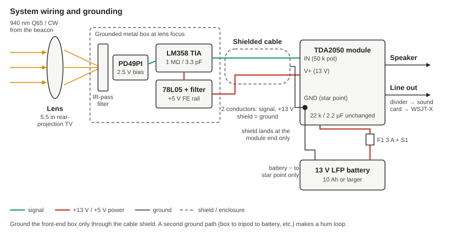
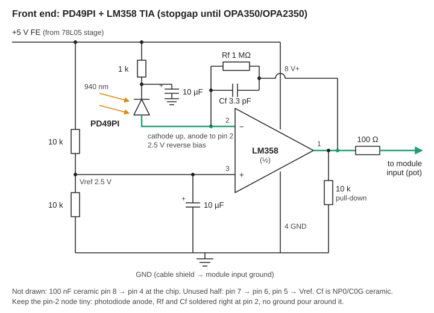

# Optical Receive Chain for 940 nm Communications

Receiver for a 940 nm free-space optical link carrying **Q65 and CW** on audio-frequency LED modulation. The receiver catches the light with a large surplus lens, converts it to a voltage with a photodiode transimpedance amplifier (TIA), and drives a TDA2050 audio amplifier module. The output feeds a speaker, or a sound card running WSJT-X or a CW decoder.

This is the **receive side**. The transmit side is the ESP8266-based Q65/CW optical beacon, documented in [rusk2ua/ve2ug-optical-beacon-project](https://github.com/rusk2ua/ve2ug-optical-beacon-project), which is K2UA's revised copy of Rene Barbeau VE2UG's design.

**Release:** 2026.10.10 · **Author:** Rus Healy, K2UA · **License:** MIT



## Signal chain

1. **Lens:** a 5.5 in rear-projection TV lens (surplus) focuses the beacon's light onto the photodiode.
2. **Photodiode:** a Sharp **PD49PI** PIN photodiode. It has a built-in visible-light-cutoff resin, peaks near 1000 nm, and runs with **2.5 V reverse bias** to cut its capacitance from about 48 pF to about 24 pF.
3. **TIA:** an **LM358** with Rf = 1 MΩ and Cf = 3.3 pF gives about 1 V per µA of photocurrent, flat from 500 Hz to past 15 kHz. This is a stopgap until the **OPA350** arrives. See [OPA350 upgrade](docs/opa350-upgrade.md).
4. **Audio amp:** a store-bought **TDA2050 module**, unmodified. It has a 50 kΩ series volume pot, a 2.2 µF coupling cap, and 22 kΩ to ground at pin 1.
5. **Power:** one **13 V LFP battery**. It feeds the module directly, and feeds a filtered **78L05** rail that gives the front end a quiet 5 V. The OPA350 is limited to 5.5 V, so the front-end rail is 5 V now and stays 5 V after the upgrade.

## Schematics

| Drawing | What it shows |
|---|---|
| [system-wiring.svg](docs/schematics/system-wiring.svg) | Blocks, cable, star ground, outputs |
| [power-supply.svg](docs/schematics/power-supply.svg) | 13 V battery to module, plus the 78L05 front-end rail |
| [front-end-lm358.svg](docs/schematics/front-end-lm358.svg) | PD49PI and LM358 TIA, output to the module |



## Documentation

- [Design notes](docs/design-notes.md): why a TIA, the op-amp choice, Rf/Cf math, bias, noise, headroom, and the module interface
- [Power supply](docs/power-supply.md): the LFP battery, the 78L05 rail, current budget, fusing, grounding
- [Build and layout](docs/build-and-layout.md): enclosure, the pin-2 node, shielding, cable, filter, focusing
- [Test procedure](docs/test-procedure.md): DC checks, current-injection test, frequency response, the optical link
- [OPA350 upgrade](docs/opa350-upgrade.md): what changes when the OPA350 or OPA2350 goes in
- [Bill of materials](docs/bom.md)

## Tools

Python helpers live in [`tools/`](tools/README.md):

- `tia_calc.py`: calculates TIA stability, bandwidth, noise and headroom, with LM358, OPA350 and NE5532 presets. Standard library only.
- `gen_test_tones.py`: makes a WAV file of stepped equal-level tones from 500 Hz to 15 kHz. Standard library only.
- `analyze_tones.py`: measures tone level, flatness and SNR in a recording of the receiver output. Needs numpy.

```bash
python3 tools/tia_calc.py                       # LM358 stopgap as built
python3 tools/tia_calc.py --opamp opa350 --cf 2.2e-12
python3 tools/gen_test_tones.py -o tones.wav
pip install -r tools/requirements.txt
python3 tools/analyze_tones.py my_recording.wav
```

## Key numbers (LM358 build, from `tia_calc.py`)

| Item | Value |
|---|---|
| Transimpedance | 1 MΩ (1 V/µA) |
| Response, 500 Hz to 15 kHz | flat within about 0.1 dB (modeled) |
| Minimum stable Cf | about 2.2 pF (3.3 pF used) |
| Input-referred noise, 300 Hz to 20 kHz | about 37 pA RMS (LM358), about 18 pA (OPA350) |
| DC headroom | about 2.4 µA of total photocurrent before the output hits ground |
| Front-end supply | about 6 mA at 4.9 V |

The op-amp noise figures use ballpark datasheet values. Measure your own build with the test procedure.

## Repository layout

```
README.md
CHANGELOG.md
LICENSE
docs/
  design-notes.md  power-supply.md  build-and-layout.md
  test-procedure.md  opa350-upgrade.md  bom.md
  schematics/
    system-wiring.svg  power-supply.svg  front-end-lm358.svg
tools/
  README.md  requirements.txt
  tia_calc.py  gen_test_tones.py  analyze_tones.py
```

## Datasheets

The Sharp PD49PI datasheet isn't redistributed here. Its notice prohibits reproduction. You can find it on [alldatasheet.com](https://www.alldatasheet.com/datasheet-pdf/pdf/43409/SHARP/PD49PI.html). The OPA350 datasheet is on [ti.com](https://www.ti.com/product/OPA350).

## Versioning

Releases use date-based versions (`YYYY.MM.DD`), matching the beacon repo. See [CHANGELOG.md](CHANGELOG.md).
