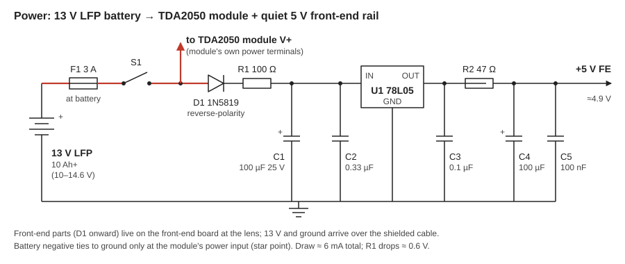

# Power supply

The whole receiver runs from a **13 V LFP battery (10 Ah or larger)**. The TDA2050 module takes battery voltage directly. The front end gets a filtered, regulated **5 V rail** from a 78L05.

## Why 5 V for the front end

- **The OPA350 is rated 2.7 to 5.5 V.** It can't run on 13 V. Building the front end around 5 V now means the op-amp upgrade is a chip swap and a Cf change, with no power rework.
- The LM358 is happy at 5 V, and a 2.5 V Vref gives the most room for the output to swing down.
- A regulator plus RC filters keeps the TDA2050's load-dependent supply ripple out of the 1 MΩ front end. The amp pulls current in bursts that follow the audio, and that ripple would otherwise feed back into the input.

## Battery voltage range

A 4-cell LFP pack runs from about 10 V near empty to 14.6 V on charge, sitting around 13.0 to 13.3 V for most of its discharge.

- **TDA2050 module:** fine across that range. Maximum output power falls off at the low end, which doesn't matter at listening levels.
- **78L05 chain:** worst case at 10 V, the drops are about 0.3 V across D1 and 0.6 V across R1, leaving about 9.1 V at the regulator input. That's well above the 78L05's minimum of about 6.7 V. At 14.6 V on charge, the regulator burns about 9 V × 6 mA ≈ 55 mW, which is trivial.

## Component by component

| Ref | Part | Purpose |
|---|---|---|
| F1 | 3 A fuse, at the battery | Protects the wiring. Size it to your module's peak draw, and use a fast-blow automotive blade or glass fuse. |
| S1 | Power switch | Rated for the module's current |
| D1 | 1N5819 Schottky | Reverse-polarity protection for the front end. The drop is about 0.3 V. The module needs its own protection if it lacks it. |
| R1, C1 | 100 Ω, 100 µF 25 V | Pre-filter at about 16 Hz. It knocks down amp-induced ripple before the regulator. |
| C2 | 0.33 µF | 78L05 input cap, per the datasheet |
| U1 | 78L05 (TO-92) | 5 V regulation. A full-size 7805 also works. |
| C3 | 0.1 µF | 78L05 output cap, for stability |
| R2, C4, C5 | 47 Ω, 100 µF, 100 nF | Post-filter at about 34 Hz. It strips the regulator's own wideband noise (78L05s are roughly 40 µV RMS). |

The front end then adds its own filtering on top of this rail. The Vref divider has a 10 µF cap, and the photodiode bias has 1 kΩ with 10 µF, so supply noise sees several stages of RC attenuation before it reaches the 1 MΩ node.

## Current budget

| Load | Current |
|---|---|
| LM358 (both halves) | about 0.7 mA |
| Vref divider (10 k + 10 k) | about 0.25 mA |
| 10 k output pull-down | about 0.25 mA |
| 78L05 quiescent | about 3 to 5 mA |
| **Front-end total** | **about 6 mA** |
| TDA2050 module, idle | roughly 50 to 100 mA (check your board) |
| TDA2050 module, loud | hundreds of mA to an amp or more |

At low listening levels, a 10 Ah battery runs this for days. The 78L05's own quiescent current is most of the front-end draw. If that ever matters, a low-quiescent LDO such as an MCP1700-5002 is a drop-in electrical improvement, though it has a different pinout.

R1 drops about 6 mA × 100 Ω = 0.6 V and R2 about 1.5 mA × 47 Ω = 70 mV, so the front-end rail sits near **4.9 V**, and Vref near **2.45 V**.

## Grounding

This is where hum comes from, so it gets its own section. See [system-wiring.svg](schematics/system-wiring.svg).

1. **One star point:** the module's power-input ground terminal. The battery negative goes there and nowhere else.
2. **Front-end ground** reaches the star point only through the **cable shield**, which lands at the module end on the input ground.
3. The **front-end metal box** connects to the front-end ground at the board, and to nothing else. Don't let the box, its mount or a tripod form a second path back to the battery or the module chassis.
4. **Speaker currents** stay on the module's output and power ground traces. Don't return the speaker to the front-end ground.

Because the front-end board carries its own regulator, the cable only carries +13 V, signal, and a few milliamps of ground return. Noise picked up on the +13 V conductor is removed by the regulator and its RC filters at the board.

## Charging

Run from the battery alone when you're chasing weak signals. A switching charger or DC-DC supply connected while you operate will inject switching noise and possibly create a ground loop.
